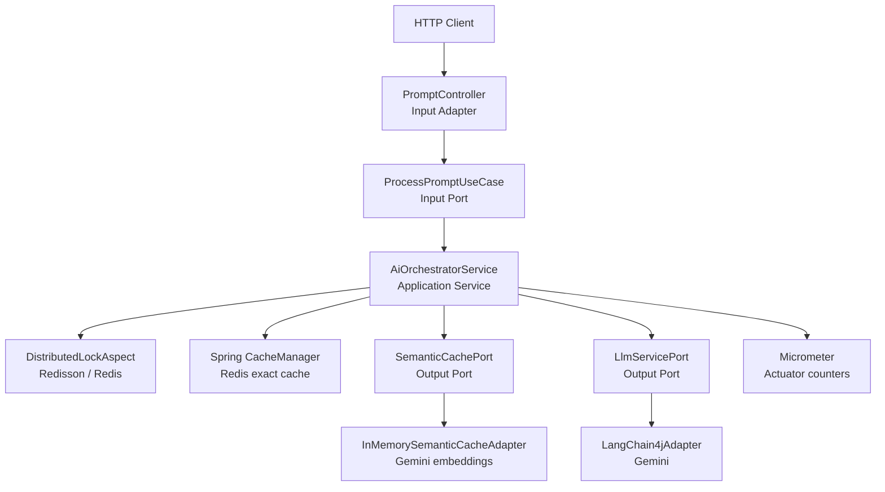

# Race for AI — Distributed AI Gateway POC

> A Java 21 + Spring Boot proof of concept that protects an LLM-backed API from duplicate concurrent calls using a distributed lock, exact Redis caching, semantic caching with Gemini embeddings, and Micrometer metrics.

This project started from a simple question:

**What happens when many users send the same prompt to an AI-powered API at the same time?**

Without protection, every request reaches the LLM. The result is duplicated cost, wasted quota, higher latency, and a classic race condition known as the **thundering herd** problem. This POC shows how to solve it with a small, production-minded architecture built around hexagonal layers.

---

## Table of Contents

1. [Overview](#overview)
2. [The Problem](#the-problem)
3. [The Solution](#the-solution)
4. [Why AI, LLMs, and Embeddings Are Central](#why-ai-llms-and-embeddings-are-central)
5. [Architecture](#architecture)
6. [Request Flow](#request-flow)
7. [Project Structure](#project-structure)
8. [Tech Stack](#tech-stack)
9. [Configuration](#configuration)
10. [Running Locally](#running-locally)
11. [API Usage](#api-usage)
12. [Metrics](#metrics)
13. [Tests](#tests)
14. [Design Decisions](#design-decisions)
15. [Limitations and Trade-offs](#limitations-and-trade-offs)
16. [Future Work](#future-work)
17. [Conclusion](#conclusion)

---

## Overview

This POC exposes a single endpoint:

```http
POST /api/v1/ai/generate
Content-Type: application/json

{
  "prompt": "Explain distributed locks in one sentence."
}
```

Behind that endpoint, the application:

- Acquires a **distributed lock** in Redis for the prompt, so concurrent identical requests do not all reach the AI provider.
- Checks an **exact cache** in Redis.
- Checks a **semantic cache** backed by Gemini embeddings and cosine similarity.
- Calls the **LLM** only when both caches miss.
- Returns the response with an `X-Cache-Type` header indicating where it came from.
- Records counters for AI calls, cache hits, and locks through **Micrometer/Actuator**.
- Proves the race-condition fix with a **Testcontainers test using 50 concurrent threads**.

Cache types:

| Header value | Meaning |
| --- | --- |
| `EXACT_HIT` | The same prompt was already answered and found in Redis. |
| `SEMANTIC_HIT` | A different but semantically similar prompt was found in the in-memory vector cache. |
| `MISS` | No cache matched; the LLM was called and both caches were updated. |

---

## The Problem

### 1. The race condition / thundering herd

Imagine a popular prompt or a burst of retries from a client:

```text
Thread 1 ─┐
Thread 2 ─┤
Thread 3 ─┼──► cache is empty ──► all call the LLM ──► duplicate cost
Thread 4 ─┤
Thread N ─┘
```

All requests check the cache before anyone has written the result. Every request sees a miss and calls the LLM independently. With 50 simultaneous requests, the AI provider can receive 50 identical calls.

This is expensive and unnecessary:

- The same tokens are paid for many times.
- The provider quota is consumed faster.
- Latency increases under load.
- Responses may differ between calls, even for the same prompt.
- Downstream systems receive duplicated work.

### 2. Exact repetition is not the only duplication

A normal cache only helps when the prompt is byte-for-byte identical. Real users rarely repeat themselves exactly:

```text
"Explain distributed locks"
"Can you explain distributed locking?"
"What is a distributed lock?"
```

These are different strings but the same intent. A traditional key-value cache treats them as three separate prompts and pays for three LLM calls.

### 3. LLM calls are expensive and slow

LLM inference is not like a local method call. It involves:

- Network round trips to an external provider.
- Token-based billing.
- Variable latency, often seconds.
- Rate limits and quotas.
- Possible provider outages.

For an AI gateway, protecting the LLM is therefore both a **cost optimization** and a **resilience concern**.

---

## The Solution

The solution is layered. Each layer handles a different kind of duplication.

```text
Incoming prompt
      │
      ▼
┌─────────────────────────────┐
│ 1. Distributed lock         │  Redisson / Redis
│    (one request per prompt) │
└──────────────┬──────────────┘
               │
               ▼
┌─────────────────────────────┐
│ 2. Exact cache              │  Redis, 10-minute TTL
│    (same string)            │
└──────────────┬──────────────┘
               │ miss
               ▼
┌─────────────────────────────┐
│ 3. Semantic cache           │  Gemini embeddings + cosine similarity
│    (same meaning)           │  in-memory, threshold 0.95
└──────────────┬──────────────┘
               │ miss
               ▼
┌─────────────────────────────┐
│ 4. LLM call                 │  Gemini via LangChain4j
│    then store in both caches│
└─────────────────────────────┘
```

### 1. Distributed lock

A custom `@DistributedLock` annotation marks the orchestration method. A Spring AOP aspect acquires a Redisson `RLock` using a key derived from the prompt hash:

```java
@DistributedLock(key = "#query.hash", waitTime = 5, leaseTime = 10)
public AiAnswer process(PromptQuery query) {
    // exact cache -> semantic cache -> LLM
}
```

Behavior:

- The first request acquires the lock and proceeds.
- Concurrent requests with the same prompt wait up to **5 seconds**.
- If they acquire the lock afterward, they find the result in the exact cache and return it.
- If they cannot acquire the lock within 5 seconds, the API returns **HTTP 429** instead of hammering the LLM.

This is the key part that turns N simultaneous identical calls into **one LLM call**.

### 2. Exact cache

The exact cache is a Spring `CacheManager` backed by Redis:

- Cache name: `exact-cache`
- TTL: 10 minutes
- Keys and values serialized as plain strings
- Key: hexadecimal prompt hash
- Value: the LLM answer

The cache is checked **after** the lock is acquired. This is the double-check pattern: the first thread performs the work, and later threads entering the same lock find the value already stored.

### 3. Semantic cache

The semantic cache catches prompts that mean the same thing but use different words:

1. The prompt is converted into a vector using a Gemini embedding model.
2. The vector is compared with previously stored prompt vectors using cosine similarity.
3. If the best score is greater than or equal to the configured threshold (`0.95`), the stored answer is returned.
4. Otherwise, the request proceeds to the LLM and the new prompt/answer pair is stored.

The semantic cache sits behind the `SemanticCachePort`, so the in-memory implementation can later be replaced by RedisSearch, pgvector, Qdrant, or another vector store without changing the application layer.

### 4. Cache source header

The controller returns the cache source as an HTTP header, keeping the response body clean:

```http
HTTP/1.1 200 OK
X-Cache-Type: SEMANTIC_HIT
Content-Type: application/json

{
  "answer": "..."
}
```

### 5. Observability

Micrometer counters are incremented at the relevant points:

- `ai.calls.total`
- `ai.cache.exact.hits`
- `ai.cache.semantic.hits`
- `ai.locks.acquired`
- `ai.locks.timeouts`

They are exposed through Spring Boot Actuator, making the behavior visible and testable.

---

## Why AI, LLMs, and Embeddings Are Central

AI is not a cosmetic part of this POC. The entire design exists because LLM calls have different cost and latency characteristics than ordinary backend calls.

### The LLM

The upstream AI call is implemented in `LangChain4jAdapter` using **LangChain4j** and Google's Gemini chat model:

- Model: `gemini-3.1-flash-lite`
- Library: `langchain4j-google-ai-gemini`
- API key: `LLM_API_KEY`

LangChain4j provides a clean abstraction over the provider, while the application layer only depends on the `LlmServicePort` interface.

### The embedding model

The semantic cache uses **Gemini embeddings**:

- Model: `gemini-embedding-001`
- Task type: `SEMANTIC_SIMILARITY`
- Timeout: 15 seconds
- Retries: 2

An embedding model converts text into a numeric vector. Texts with similar meaning end up close together in vector space, even when their words differ. That is what allows the gateway to recognize:

```text
"Explain distributed locks"
"Can you explain distributed locking?"
```

as the same intent.

### Cosine similarity

The similarity between the incoming prompt and each stored prompt is computed with cosine similarity:

```java
double score = CosineSimilarity.between(queryEmbedding, storedEmbedding);
```

The best match is returned only if:

```java
score >= 0.95
```

The threshold is intentionally strict. A lower value increases cache hits but also increases the risk of returning an answer to a meaningfully different question. `0.95` is a conservative default for this POC and is configurable.

### Why AI caching is different

Traditional caching is exact. AI caching must deal with natural language variation:

| Traditional cache | AI gateway cache |
| --- | --- |
| Exact string key | Exact key plus semantic similarity |
| Cheap lookup | Embedding call for semantic lookup |
| No meaning involved | Meaning is represented as vectors |
| Duplicate requests are identical | Duplicate requests may be paraphrases |

The semantic layer reduces expensive **chat** calls, but it is not free: generating an embedding is also an AI API call, though typically much cheaper than a full chat completion. The POC makes this trade-off explicit rather than hiding it.

### The AI flow in one sentence

**A prompt is first protected by a distributed lock, then matched exactly, then matched semantically, and only then sent to the LLM.**

---

## Architecture

The project keeps a hexagonal (ports and adapters) shape, deliberately simplified for a POC.



### Layers

| Layer | Responsibility | Examples |
| --- | --- | --- |
| Domain | Pure models and cache source type | `PromptQuery`, `AiAnswer`, `CacheType` |
| Application | Use case, orchestration, ports | `ProcessPromptUseCase`, `AiOrchestratorService`, `LlmServicePort`, `SemanticCachePort` |
| Infrastructure | Adapters and framework configuration | `PromptController`, `LangChain4jAdapter`, `InMemorySemanticCacheAdapter`, `DistributedLockAspect`, Redis/Actuator config |

The application service depends on abstractions, not on Redis, Gemini, or Spring MVC details. The infrastructure layer supplies the implementations.

### Why the design stays simple

The POC intentionally avoids over-engineering:

- One orchestrator service instead of multiple overlapping services.
- Direct `CacheManager` usage instead of an extra exact-cache port.
- One semantic cache port with one in-memory adapter.
- No vector database, message broker, or separate cache microservice.
- Metrics recorded with a small number of counters.

The goal is to prove the behavior clearly, not to build a full production gateway.

---

## Request Flow

```text
1. Client sends POST /api/v1/ai/generate with { "prompt": "..." }.

2. PromptController validates the request and creates a PromptQuery.
   PromptQuery computes an exact hash from the prompt.

3. DistributedLockAspect builds the lock key:
   lock:prompt:<hash>

4. The aspect tries to acquire the Redisson lock:
   - waitTime = 5 seconds
   - leaseTime = 10 seconds

5. If the lock is not acquired within 5 seconds:
   - increment ai.locks.timeouts
   - return HTTP 429

6. If acquired:
   - increment ai.locks.acquired
   - execute AiOrchestratorService.process()

7. Exact cache lookup:
   - hit  -> increment ai.cache.exact.hits, return EXACT_HIT
   - miss -> continue

8. Semantic cache lookup:
   - hit  -> increment ai.cache.semantic.hits, return SEMANTIC_HIT
   - miss -> continue

9. LLM call:
   - increment ai.calls.total
   - call Gemini through LangChain4j

10. Store the answer:
    - exact cache in Redis
    - semantic cache in memory

11. Return the answer with X-Cache-Type: MISS.

12. Release the lock in a finally block if the current thread still owns it.
```

An important detail: the lock is acquired **before** the exact cache lookup. That is what guarantees that a second request cannot check the cache, miss, and start a parallel LLM call while the first request is still working. The trade-off is an extra Redis round trip for every request.

---

## Project Structure

```text
race-for-ai/
├── Docker/
│   └── docker-compose.yml              # Redis 7 instance
├── src/
│   ├── main/
│   │   ├── java/com/gateway/ai/
│   │   │   ├── RaceForAiApplication.java
│   │   │   ├── application/
│   │   │   │   ├── ports/
│   │   │   │   │   ├── in/ProcessPromptUseCase.java
│   │   │   │   │   └── out/
│   │   │   │   │       ├── LlmServicePort.java
│   │   │   │   │       └── SemanticCachePort.java
│   │   │   │   └── service/AiOrchestratorService.java
│   │   │   ├── domain/model/
│   │   │   │   ├── AiAnswer.java
│   │   │   │   ├── CacheType.java
│   │   │   │   └── PromptQuery.java
│   │   │   └── infrastructure/
│   │   │       ├── adapters/
│   │   │       │   ├── in/PromptController.java
│   │   │       │   ├── in/dto/
│   │   │       │   ├── out/cache/InMemorySemanticCacheAdapter.java
│   │   │       │   ├── out/llm/LangChain4jAdapter.java
│   │   │       │   └── out/lock/
│   │   │       │       ├── DistributedLock.java
│   │   │       │       └── DistributedLockAspect.java
│   │   │       └── config/
│   │   │           ├── BeanConfiguration.java
│   │   │           ├── CacheConfig.java
│   │   │           └── EmbeddingConfig.java
│   │   └── resources/
│   │       ├── application.properties
│   │       └── Requests.http             # Ready-to-run HTTP examples
│   └── test/
│       └── java/com/gateway/ai/
│           ├── ConcurrencyWithRedisTestcontainersTest.java
│           ├── application/service/AiOrchestratorServiceUnitTest.java
│           └── infrastructure/adapters/out/cache/InMemorySemanticCacheAdapterTest.java
├── .env                                 # LLM_API_KEY (git-ignored)
├── pom.xml
└── README.md
```

---

## Tech Stack

| Technology | Version / Role |
| --- | --- |
| Java | 21 |
| Spring Boot | 4.1.2 |
| Spring Web | REST endpoint |
| Spring Data Redis | Exact cache |
| Redisson | Distributed lock |
| Spring AOP | Lock aspect |
| LangChain4j | Gemini chat and embedding integration |
| Gemini chat model | `gemini-3.1-flash-lite` |
| Gemini embedding model | `gemini-embedding-001` |
| Micrometer + Actuator | Metrics and health endpoints |
| Testcontainers | Real Redis for the concurrency test |
| Docker Compose | Local Redis runtime |
| Maven | Build and test |

---

## Configuration

### Environment variables

| Variable | Description |
| --- | --- |
| `LLM_API_KEY` | Gemini API key used by both the chat model and the embedding model. |

Create a `.env` file in the project root:

```properties
LLM_API_KEY=your-gemini-api-key
```

The `.env` file is already excluded by `.gitignore`. Do not commit real API keys.

### Application properties

```properties
spring.config.import=optional:file:.env[.properties]
spring.data.redis.host=localhost
spring.data.redis.port=6379

ai.embedding.model=gemini-embedding-001
ai.semantic-cache.threshold=0.95

management.endpoints.web.exposure.include=health,metrics
management.endpoint.metrics.enabled=true
```

### Key settings

| Setting | Default | Where |
| --- | --- | --- |
| Redis host | `localhost` | `application.properties` |
| Redis port | `6379` | `application.properties` |
| Exact cache TTL | 10 minutes | `CacheConfig` |
| Lock wait time | 5 seconds | `@DistributedLock` |
| Lock lease time | 10 seconds | `@DistributedLock` |
| Semantic threshold | `0.95` | `ai.semantic-cache.threshold` |
| Embedding model | `gemini-embedding-001` | `ai.embedding.model` |
| Chat model | `gemini-3.1-flash-lite` | `LangChain4jAdapter` |

> **Important:** if you previously ran an older version of this POC with JSON values in Redis, flush the `exact-cache` entries. The cache now stores plain strings. You can flush the local Redis with `docker exec -it redis-ai-gateway redis-cli FLUSHALL`.

---

## Running Locally

### Prerequisites

- JDK 21
- Maven 3.9+
- Docker with Docker Compose
- A Gemini API key

### 1. Start Redis

```bash
docker compose -f Docker/docker-compose.yml up -d
```

Verify:

```bash
docker ps
```

You should see a container named `redis-ai-gateway` exposing port `6379`.

### 2. Configure the API key

Create the `.env` file as shown in [Configuration](#configuration).

### 3. Run the application

```bash
mvn spring-boot:run
```

The API starts on `http://localhost:8080`.

If `mvn` is not available on your `PATH`, use the Maven bundled with your IDE or a Maven wrapper. On Windows with IntelliJ IDEA, for example, the bundled Maven executable can be used directly.

### 4. Stop Redis

```bash
docker compose -f Docker/docker-compose.yml down
```

---

## API Usage

### First request — cache miss

```bash
curl -i -X POST http://localhost:8080/api/v1/ai/generate \
  -H "Content-Type: application/json" \
  -d '{"prompt":"Explain distributed locks in one sentence."}'
```

Expected:

```http
HTTP/1.1 200 OK
X-Cache-Type: MISS
Content-Type: application/json

{"answer":"..."}
```

### Same request again — exact hit

Run the same command again. The prompt is identical, so Redis returns the stored answer without calling the LLM:

```http
HTTP/1.1 200 OK
X-Cache-Type: EXACT_HIT

{"answer":"..."}
```

### Paraphrased request — semantic hit

```bash
curl -i -X POST http://localhost:8080/api/v1/ai/generate \
  -H "Content-Type: application/json" \
  -d '{"prompt":"Can you explain distributed locking in one sentence?"}'
```

If the embedding similarity is at least `0.95`, the answer comes from the semantic cache:

```http
HTTP/1.1 200 OK
X-Cache-Type: SEMANTIC_HIT

{"answer":"..."}
```

### Duplicate request while the first is still running

If a concurrent identical request cannot acquire the lock within 5 seconds, Spring returns a `429 Too Many Requests` response. The exact body follows Spring Boot's standard error format; the reason message is set to `Requisição duplicada em processamento. O sistema está protegendo a cota da LLM.`

```http
HTTP/1.1 429 Too Many Requests
Content-Type: application/json

{
  "timestamp": "...",
  "status": 429,
  "error": "Too Many Requests",
  "path": "/api/v1/ai/generate"
}
```

The 429 is intentional: it protects the provider quota instead of allowing an unbounded queue of duplicate LLM calls.

### Ready-made requests

The file `src/main/resources/Requests.http` contains the three scenarios:

1. Base request (`MISS`)
2. Concurrent duplicate request (`EXACT_HIT` after the first finishes)
3. Paraphrased request (`SEMANTIC_HIT`)

It can be executed directly from IntelliJ IDEA's HTTP client.

---

## Metrics

Actuator exposes health and metrics:

```bash
curl http://localhost:8080/actuator/health
curl http://localhost:8080/actuator/metrics
```

Inspect individual counters:

```bash
curl http://localhost:8080/actuator/metrics/ai.calls.total
curl http://localhost:8080/actuator/metrics/ai.cache.exact.hits
curl http://localhost:8080/actuator/metrics/ai.cache.semantic.hits
curl http://localhost:8080/actuator/metrics/ai.locks.acquired
curl http://localhost:8080/actuator/metrics/ai.locks.timeouts
```

| Metric | Meaning |
| --- | --- |
| `ai.calls.total` | Number of times the application actually called the LLM. |
| `ai.cache.exact.hits` | Number of requests served by the exact Redis cache. |
| `ai.cache.semantic.hits` | Number of requests served by the semantic cache. |
| `ai.locks.acquired` | Number of distributed locks successfully acquired. |
| `ai.locks.timeouts` | Number of requests that failed to acquire the lock and returned 429. |

A healthy concurrency test shows `ai.calls.total` increasing by exactly 1 while `ai.cache.exact.hits` grows with the number of duplicate requests.

---

## Tests

Run all tests:

```bash
mvn test
```

Expected result:

```text
Tests run: 5, Failures: 0, Errors: 0, Skipped: 0
BUILD SUCCESS
```

### Test coverage

| Test | What it proves |
| --- | --- |
| `AiOrchestratorServiceUnitTest.shouldCallLlmOnlyOnceAndServeSecondCallFromExactCache` | The first call is a miss; the second identical call is an exact cache hit and the LLM is called only once. |
| `AiOrchestratorServiceUnitTest.shouldServeSimilarPromptFromSemanticCache` | A semantic cache hit returns the stored answer without touching the LLM. |
| `InMemorySemanticCacheAdapterTest.shouldReturnCachedAnswerWhenSimilarityIsAboveThreshold` | Similarity above `0.95` returns the stored answer. |
| `InMemorySemanticCacheAdapterTest.shouldMissWhenSimilarityIsBelowThreshold` | Similarity below `0.95` is treated as a miss. |
| `ConcurrencyWithRedisTestcontainersTest.shouldCallLlmExactlyOnceUnderHeavyConcurrency` | 50 simultaneous requests with the same prompt result in exactly one LLM call. |

### The concurrency proof

The integration test starts a real Redis container with Testcontainers:

```java
static final GenericContainer<?> REDIS =
        new GenericContainer<>(DockerImageName.parse("redis:7-alpine"))
                .withExposedPorts(6379);
```

It then launches 50 threads synchronized by a `CountDownLatch`, all sending the same prompt:

```java
for (int i = 0; i < THREADS; i++) {
    futures.add(executor.submit(() -> {
        start.await();
        return processPromptUseCase.process(
                new PromptQuery("Como funciona lock distribuído?"));
    }));
}
```

The central assertion is:

```java
Mockito.verify(llmServicePort, Mockito.times(1)).generate(anyString());
```

In other words: **50 concurrent requests, 1 LLM call.**

The LLM and embedding model are mocked in this test, so it validates the gateway behavior without spending real API quota. Redis is real, because the distributed lock and exact cache are exactly what the test needs to exercise.

> Docker must be running for the Testcontainers test. The first run may take longer while the `redis:7-alpine` image is pulled.

---

## Design Decisions

### One orchestrator, not many services

`AiOrchestratorService` contains the complete decision flow: lock, exact cache, semantic cache, LLM, store. Keeping it in one place makes the POC easy to read and reason about.

### Direct `CacheManager` instead of an extra port

Spring's `CacheManager` is already a stable abstraction. Adding another exact-cache port would have increased ceremony without improving the demonstration.

### Semantic cache behind a port

The semantic cache is the part most likely to change in production. `SemanticCachePort` isolates that decision, so the in-memory adapter can be replaced without touching the orchestrator.

### Plain-string Redis values

The exact cache stores strings using `RedisSerializer.string()`. This keeps Redis contents readable and avoids the serialization issues that appeared with JSON values in earlier iterations.

### Lock before cache lookup

Acquiring the lock before the cache check is what guarantees no duplicate LLM call. A fast-path cache check before the lock could reduce latency, but it would reintroduce a race window unless carefully combined with a second check after locking.

### HTTP 429 for lock timeouts

Rejecting duplicate work is better than queueing it indefinitely. The client receives a clear signal instead of consuming provider quota in parallel.

### Metrics instead of logs only

Counters make the cache and lock behavior observable in tests and in local experiments. They are also the natural starting point for a Prometheus/Grafana dashboard.

---

## Limitations and Trade-offs

This is a proof of concept. The following limitations are intentional and should be addressed before production use.

### 1. The semantic cache is in memory

`InMemorySemanticCacheAdapter` stores vectors in a `ConcurrentHashMap`:

- It works only within a single application instance.
- It is lost on restart.
- It is not shared between replicas.
- It grows without an eviction policy.

For production, replace it with a vector store such as RedisSearch, pgvector, Qdrant, or another managed vector database.

### 2. Semantic search is O(n)

Every semantic lookup compares the query embedding against every stored entry. This is acceptable for tens or hundreds of entries, but not for large volumes. A vector index is required at scale.

### 3. Concurrent paraphrased prompts can still duplicate LLM calls

The lock key is based on the **exact prompt hash**. Two semantically equivalent prompts arriving at the same time use different lock keys, so both can miss the semantic cache and call the LLM.

Fixing this would require a semantic or coarser-grained lock strategy, which adds complexity and contention. It is deliberately out of scope for this POC.

### 4. Exact hash collisions are possible

The exact cache key uses `Integer.toHexString(prompt.hashCode())`. Java `hashCode()` is not collision-resistant. For production, use a cryptographic hash such as SHA-256.

### 5. `leaseTime = 10s` can expire during a long LLM call

Redisson releases the lock automatically after the lease time. If the LLM takes longer than 10 seconds, the lock can expire while the first request is still running. In production, use a watchdog, a longer lease, or a design that renews the lock while the LLM call is in progress.

Also, `waitTime = 5s` means duplicate requests may receive a 429 even though the first request is still legitimately working. Tune both values to the expected LLM latency.

### 6. Embeddings are not free

A semantic lookup requires an embedding call. On a full miss, the prompt is embedded once for the lookup and again when it is stored, so a miss can cost two embedding calls. This is usually much cheaper than a chat completion, but it is not zero.

### 7. No cache invalidation or versioning

Cached answers remain until the Redis TTL expires or the process restarts. There is no mechanism to invalidate answers when the underlying model, prompt template, or knowledge changes. Production systems should include a cache version or namespace in the key.

### 8. Threshold tuning is a trade-off

A high threshold (`0.95`) favors precision and may miss valid paraphrases. A lower threshold increases hit rate but risks returning an answer to a different question. The right value depends on the domain and should be evaluated with real data.

### 9. No authentication, authorization, or per-user rate limiting

The POC exposes an open endpoint. Production needs API keys, user identity, quotas, and abuse protection.

### 10. No retry, fallback, or circuit breaker around the LLM

If the provider is slow or unavailable, the request fails. Resilience patterns such as timeouts, retries with backoff, fallbacks, and circuit breakers are not implemented.

### 11. The `.env` file contains a real key during local development

The key is git-ignored, but it still exists on disk. Rotate any key that may have been exposed, and use a secret manager in deployed environments.

### 12. Old Redis entries must be flushed after serializer changes

If the exact cache previously stored JSON and now stores strings, old entries can cause deserialization problems. Flush the cache before testing the new behavior.

---

## Future Work

Natural next steps for evolving the POC:

1. **Replace the in-memory semantic cache** with RedisSearch, pgvector, or Qdrant.
2. **Add a semantic lock strategy** or a short-lived "in-flight" marker keyed by embedding, so paraphrased duplicates can also be deduplicated.
3. **Use SHA-256** for exact cache keys and include a model/prompt-template version in the key.
4. **Add TTL and eviction** to semantic entries.
5. **Tune `waitTime` and `leaseTime`** based on real LLM latency, or use a Redisson watchdog.
6. **Integrate Prometheus and Grafana** for dashboards and alerts.
7. **Add resilience patterns**: timeouts, retries, circuit breakers, and fallback models.
8. **Add authentication and per-client rate limiting**.
9. **Propagate trace context** to correlate HTTP requests, locks, cache lookups, and LLM calls.
10. **Add contract and load tests** for the HTTP layer.
11. **Evaluate the semantic threshold** with a labeled dataset of real prompts.
12. **Move the semantic cache to a shared store** so multiple replicas see the same entries.

---

## Conclusion

The POC demonstrates a practical answer to a real AI engineering problem:

- A **distributed lock** prevents concurrent identical prompts from calling the LLM in parallel.
- An **exact Redis cache** serves repeated prompts immediately.
- A **semantic cache with Gemini embeddings** serves paraphrased prompts without another chat completion.
- **Micrometer metrics** make the behavior visible.
- A **Testcontainers concurrency test** proves the main claim: 50 simultaneous requests, one LLM call.

The architecture stays intentionally small while preserving hexagonal boundaries. The expensive AI-specific pieces — the semantic cache implementation and the lock strategy — are isolated behind ports and can evolve independently as the system moves toward production.
